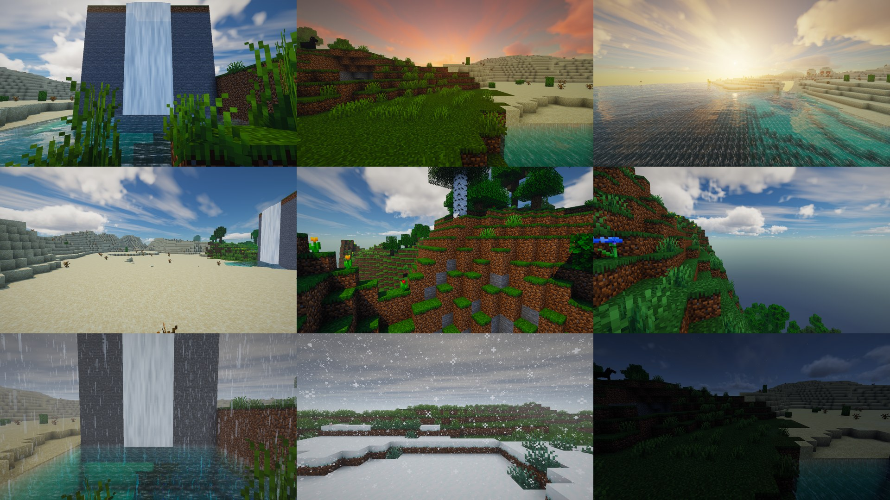

# Montella Realism — gerçekçi shader paketi / realistic shader pack

Minecraft **1.20.1 Forge** için gerçekçi shader paketi. **Oculus** (Forge için Iris) ile çalışır; Iris (Fabric) ile de uyumludur.

## Kurulum

1. Forge 1.20.1'e şu iki modu kurun (`mods/` klasörüne):
   - **Embeddium** (Forge için Sodium) — `embeddium-0.3.31+mc1.20.1.jar` veya daha yeni
   - **Oculus** — `oculus-mc1.20.1-1.8.0.jar` veya daha yeni
2. `../dist/MontellaRealism-1.0.zip` dosyasını **açmadan** `.minecraft/shaderpacks/` klasörüne koyun.
3. Oyunda: *Seçenekler → Görüntü Ayarları → Shader Packs* → **MontellaRealism** → Uygula.
4. Ayarlar sayfasında profil seçin: **Low / Medium / High (varsayılan) / Ultra**.

## Neler var

| | |
|---|---|
| **Gökyüzü** | Fiziksel atmosfer (Rayleigh + Mie + ozon); gün doğumunda/batımında gerçek kızıl-turuncu renkler, gece mavi ay ışıklı gökyüzü, parlayan yıldızlar ve Samanyolu bandı, gerçek güneş diski |
| **Bulutlar** | Işın izlemeli hacimsel kümülüs bulutları (güneşle aydınlanan kenarlar, koyu alt yüzler), yüksek sirrus bulutları, rüzgarla hareket, bulut gölgeleri |
| **Işık** | Yumuşak gölgeler (PCF), renkli gölgeler (vitray), gökyüzü ortam ışığı, SSAO, yaprak ve çimlerde ışık geçirgenliği, sıcak meşale ışığı |
| **Su** | Dalgalı yüzey, ekran-uzayı yansımalar + gökyüzü/bulut yansıması, kırılma, derinliğe göre turkuaz → koyu mavi emilim, güneş parıltısı, su altı ışık desenleri (kostik), su altı sisi |
| **Şelale** | Düşen su beyaz köpük ve hızla akan çizgilerle |
| **Yağmur / kar** | İnce yarı saydam yağmur, ıslanan zemin, su birikintileri ve damla halkaları, kapalı gri gökyüzü, kar yağışı |
| **Bitkiler** | Rüzgarda dalgalanan çim, çiçek, ekin ve yapraklar (rüzgar hamleleriyle) |
| **Atmosfer** | Yükseklik sisi, uzak mesafede gökyüzüne karışma, ışık huzmeleri (god rays), gün batımı pusu |
| **Kamera** | Otomatik pozlama, bloom, film tonlama, doygunluk/kontrast, vinyet, keskinleştirme |
| **Boyutlar** | Nether (kızıl sis) ve End için ayrı ayarlar |

Tüm ayarlar oyun içindeki shader ayar menüsünden (Türkçe / English) değiştirilebilir.

## Notlar

- Minecraft blokları 16×16 piksel dokulardır; shader ışık, gökyüzü, su ve atmosferi gerçekçi yapar ama blokların
  şeklini değiştiremez. Daha da gerçekçi bir görünüm için yüksek çözünürlüklü bir kaynak paketi ekleyin
  (LabPBR normal haritaları desteklenir).
- Hacimsel bulutlar ve gölgeler ekran kartını yorar. FPS düşükse profili **Medium** veya **Low** yapın,
  ya da *Bulut Kalitesi* ve *Gölge Çözünürlüğü*nü düşürün.

## Geliştirme

- `MontellaRealism/shaders/program/*.glsl` — asıl shader kodu, `lib/` — ortak kütüphaneler (atmosfer, bulutlar, su, gölge)
- Kök dizindeki ve `world-1/`, `world1/` içindeki `.vsh/.fsh` dosyaları `gen_wrappers.py` ile üretilir.
- Paket zip'i: `cd MontellaRealism && zip -r ../../dist/MontellaRealism-1.0.zip shaders`
