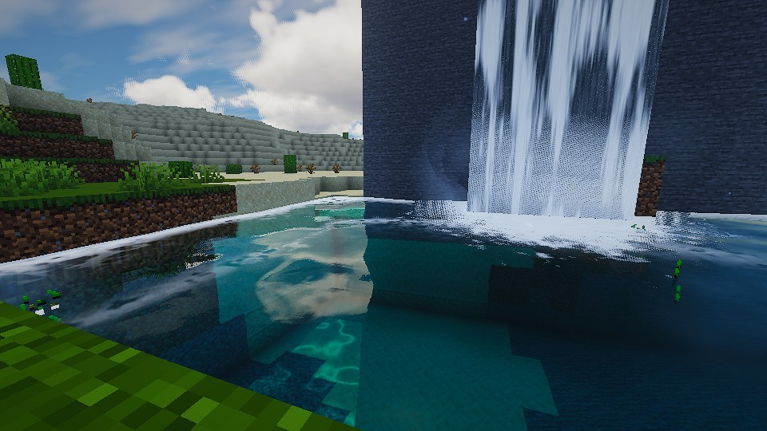

# Montella Water Physics / Montella Su Fiziği

Minecraft **1.20.1 Forge** için gerçekçi su modu. Shader olmadan da çalışır; **Montella Realism** shader paketiyle en iyi sonucu verir.

## Kurulum

`dist/montella_water_physics-1.20.1-forge-1.0.0.jar` dosyasını `mods/` klasörüne koyun (Forge 47+). Başka mod gerekmez.
Sunucuda oynuyorsanız fizik için modun sunucuda da kurulu olması gerekir (görsel ve ses kısmı istemcide çalışır).

## Neler var

| | |
|---|---|
| **Şelaleler** | Çevrendeki şelaleleri kendisi bulur, yüksekliğini ölçer. Çarpma noktasında damlacıklar saçılır, sis yükselir, köpük havuza yayılır, halkalar açılır; düşen perdeden damlalar kopar. Hepsi yüksekliğe göre büyür. |
| **Şelale sesi** | Yükseklik ve genişliğe göre güçlenen, uzaktan duyulan gürleme (yüksek şelale daha derin). |
| **Akıntı** | Akan su seni, canlıları ve tekneleri suyun hızına doğru sürükler (sürtünme modeli: hafif şey çabuk, ağır şey yavaş kapılır). |
| **Şelale baskısı** | Düşen su içindekini aşağı bastırır; şelaleye yüzerek tırmanmak artık mümkün değil. |
| **Sıçramalar** | Suya düşen her şey hızına ve boyuna göre taç şeklinde su, halkalar, köpük ve ses çıkarır; büyük düşüşlerde su sütunu fışkırır. |
| **Dümen suyu** | Suda ilerleyen oyuncu, canlı ve teknelerin arkasında halkalar, iki yana açılan köpük, hızlıyken serpinti. |
| **Yağmur** | Damlalar su yüzeyinde küçük halkalar ve sıçramalar yapar. |
| **Dere sesi** | Yakındaki akan suyun miktarına göre şırıldama. |

## Ayarlar

- `config/montella_water-client.toml`: parçacık yoğunluğu, şelale arama mesafesi, sesler, sıçrama / dümen suyu / yağmur halkaları
- `config/montella_water-common.toml`: `currentStrength` (akıntı gücü), `waterfallPush` (şelale baskısı); 0 = vanilla

## Geliştirme

- `forge-1.20.1/` — Gradle projesi (`gradle build`, JDK 17)
- `tools/gen_assets.py` — parçacık dokuları ve sesler tamamen prosedürel üretilir (numpy/scipy; hazır kayıt kullanılmaz)
